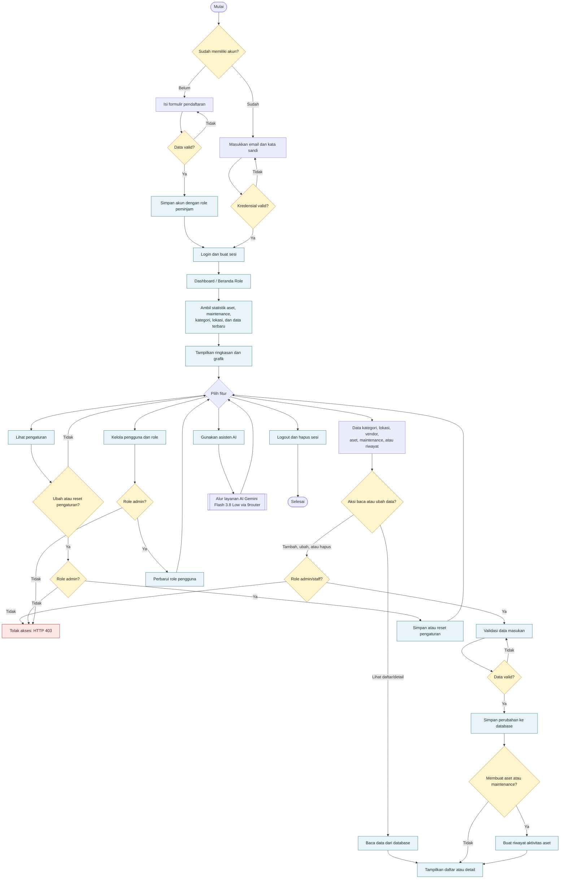
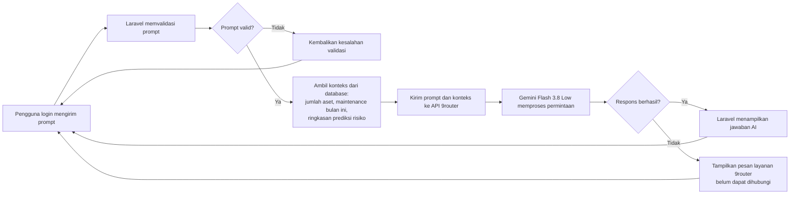

# Flowchart Sistem Manajemen Aset

## Alur Utama

## Alur Asisten AI (Gemini Flash 3.8 Low via Antigravity 9router)

## Catatan Akses

- Semua halaman aplikasi utama, termasuk dashboard, daftar/detail data, pengaturan, dan asisten AI, memerlukan login.
- Pengguna yang mendaftar mandiri otomatis mendapat role `peminjam`; pembuatan atau promosi ke akun `staff`, `pimpinan`, atau `admin` dilakukan melalui pengelolaan role oleh admin yang sudah ada.
- Akses tambah, ubah, dan hapus data master/transaksi, pengaturan, serta pengelolaan role dibatasi untuk admin/staff sesuai matriks hak akses.
- Pembuatan aset, mutasi, peminjaman, dan maintenance menghasilkan catatan pada riwayat aset.
- Alur AI menggunakan data ringkasan real-time dari database aplikasi dan terhubung langsung via HTTP ke Antigravity 9router API menggunakan model `gemini-3.8-flash-low`.